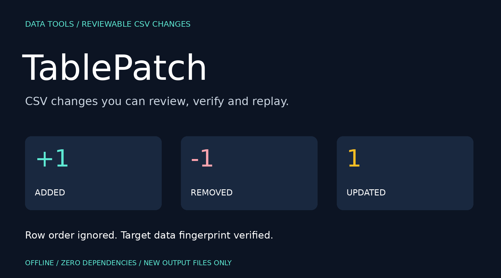
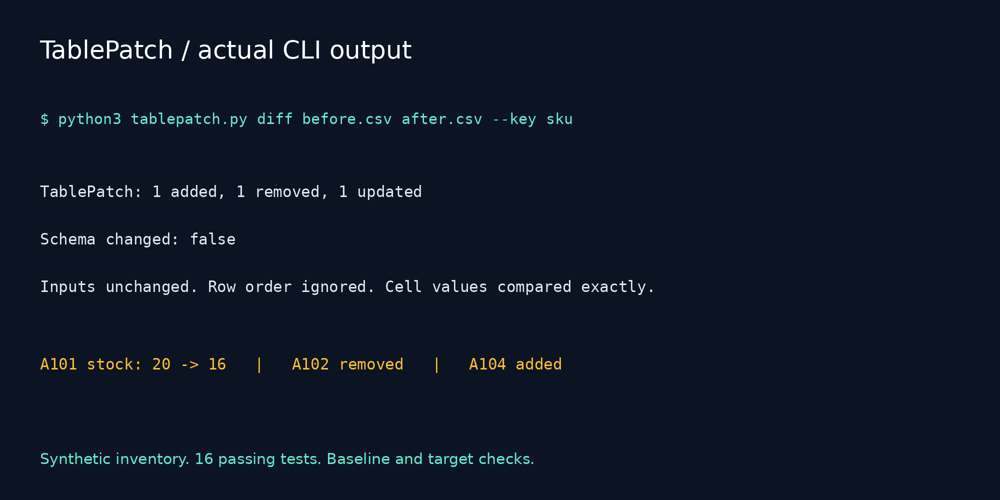

# TablePatch



  

**CSV changes you can review, verify and replay.**

TablePatch compares two CSV files using a unique key column, produces a JSON change set and an optional standalone HTML review, then applies that patch to a matching baseline to create a new CSV. Logical SHA256 fingerprints verify the baseline and reconstructed result.

It ignores row and column ordering for data comparisons, while keeping the target column order when rebuilding. No spreadsheet application, server, database or third-party package is required.

## Who it helps

Review recurring inventory exports, product lists, localization tables, research data or CRM exports when line-by-line diffs are dominated by sorting changes. This is a small developer and analyst utility, not a claim of a new category or universal CSV compatibility.

## Quick start

Python 3.10+ is required. Download or clone this repository, then open its directory:

```bash
python3 tablepatch.py diff examples/before.csv examples/after.csv --key sku
python3 tablepatch.py diff examples/before.csv examples/after.csv --key sku --patch changes.json --html review.html
python3 tablepatch.py apply examples/before.csv changes.json --output rebuilt.csv
python3 -m unittest discover -v
```

On Windows use `py -3` if needed. No pip installation is required. All output paths must be new: delete or rename your own previous outputs before reusing a command with the same output paths. The tool itself never overwrites an existing file.

Expected comparison output:

```text
TablePatch: 1 added, 1 removed, 1 updated
Schema changed: false
Inputs unchanged. Row order ignored. Cell values compared exactly.
```

Expected apply output:

```text
Applied patch: 3 rows. Target fingerprint verified.
Created a new CSV. Existing files were not overwritten.
```

## Included example

Before:

```csv
sku,name,stock,price
A101,Notebook,20,12.00
A102,Pen,50,3.00
A103,Folder,15,5.00
```

After (columns and rows reordered):

```csv
price,stock,name,sku
5.00,15,Folder,A103
18.00,8,Desk Pad,A104
12.00,16,Notebook,A101
```

Results:

| Key | Change |
| --- | --- |
| A101 | stock changes from 20 to 16 |
| A102 | removed |
| A103 | unchanged despite reordered placement |
| A104 | added |

The repository includes the generated [JSON patch](examples/changes.json), [HTML review](examples/review.html) and [rebuilt CSV](examples/rebuilt.csv). Download the HTML file to view it in your browser. The rebuilt file is sorted lexically by key, so row order can differ from the target; its logical fingerprint matches.

## Design

- Explicit unique string key; empty/whitespace-only and duplicate keys are rejected.
- UTF-8 and UTF-8 BOM input; quoted commas, quoted newlines and Unicode values supported.
- Strict headers and row widths; duplicate/empty headers and malformed rows fail instead of being guessed.
- Added, removed and updated rows are recorded with full before/after values.
- Added or removed columns are supported; target schema is checked during apply.
- SHA256 logical fingerprints ignore row order, header order, quoting style, BOM and line endings, but preserve exact cell strings and column names.
- Existing outputs, including symlinks, are refused through exclusive creation.
- HTML escapes data, contains no JavaScript or external resources and uses a restrictive content security policy.

Patch hashes protect against accidental mismatch and incomplete changes; they are **not signatures**. Someone able to alter a patch can also recompute its hashes. Review patches from trusted sources.

## CLI reference

```bash
python3 tablepatch.py diff BEFORE.csv AFTER.csv --key COLUMN [--patch NEW.json] [--html NEW.html] [--check] [--delimiter ';']
python3 tablepatch.py apply BEFORE.csv PATCH.json --output NEW.csv [--delimiter ';']
```

The delimiter defaults to comma. Both input CSVs in a comparison must use the same delimiter. It is not auto-detected. Values remain strings: `1`, `01` and `1.0` differ; whitespace and case are significant. A changed key appears as removal plus addition. Composite keys and fuzzy matching are not implemented.

| Exit | Meaning |
| --- | --- |
| 0 | Successful comparison/application |
| 1 | `diff --check` found data or schema changes |
| 2 | Invalid input, patch mismatch, existing output or I/O error |

Schema-only changes on an empty table count for `--check`. Reordering headers alone does not. `diff` without output flags prints counts only. `--patch` saves the machine-readable artifact.

## Patch format

`tablepatch-v1` stores key, before/after column lists, logical fingerprints, full added/removed rows, and updated records containing key/before/after. Application validates the exact schema, baseline fingerprint, individual operation preconditions, unique operation keys, final row schema and final fingerprint before writing output. Unknown patch fields are rejected.

## Validation

16 tests cover changed rows, diff/apply round trips, baseline drift, patch tampering, order independence, schema changes, duplicate operations, HTML escaping, overwrite refusal, Unicode/quoted-newline/BOM handling, duplicate keys/headers, malformed widths, empty keys, empty schema-only changes, and CLI exit behavior.

## Limits and data handling

All tables and patches are processed in memory. This is intended for modest exports, not multi-gigabyte datasets. Python's standard CSV field-size limit applies. Blank physical records are ignored. Data types, spreadsheet formulas and numeric equivalence are not evaluated. Formula-like cells are preserved verbatim: opening untrusted output in a spreadsheet can still interpret formulas. This is not a spreadsheet sanitizer.

Reports and patches contain full cell values and are not redacted. Keep sensitive real data local. Included examples are synthetic. Input files are never modified. Exclusive output creation prevents overwrites; a disk/write failure may leave a partial new output, and producing both JSON and HTML is not a single atomic transaction. No automatic in-place edits, uploads or database operations occur.

## Launch kit



Arabic and English drafts: [POST.md](POST.md).

Suggested topics: `csv`, `data-diff`, `data-quality`, `python`, `developer-tools`, `data-engineering`, `offline`, `cli`.

Search phrases: CSV diff by key, replayable CSV patch, compare sorted CSV exports, verify CSV data changes.
